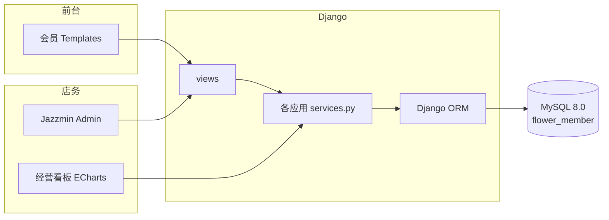

# 花间集 · 花店会员管理系统

本科毕业设计演示系统。品牌口号：**以花为集，以客为心**。

单体 Django 5.2（MVT）+ MySQL 8.0 + Django Templates + django-jazzmin + ECharts 6.0。  
核心闭环：下单 → 模拟支付 → 扣库存 → 储值抵扣 / 核销券 → 累计积分 → 等级升降 → 流水 → 看板。

> **Flower Shop Membership Management System** — an undergraduate thesis demo. Payment and store-value top-up are simulated; do **not** use this as a production shop. **Do not submit this repository as your own graduation thesis.**

[学术诚信声明](#学术诚信声明) · [快速开始](#快速开始) · [演示账号](#演示账号) · [功能](#功能概览) · [文档](#文档) · [许可](#许可与声明)

---

## 学术诚信声明

**本仓库是作者尚未答辩的本科毕业设计，禁止任何人将其作为自己的毕业论文、毕业设计、开题材料或课程大作业提交。**

完整条文见仓库根目录 [NOTICE.md](NOTICE.md)。要点如下：

- 题目、代码、文档、截图与业务规则均为作者本人的学位论文工作，答辩尚未开始。
- 不得删作者信息、换封面或改品牌名后伪称原创；不得把核心实现改头换面写入他人论文。
- 允许在注明出处后阅读、本机运行或作简短引用。**阅读、运行、引用 ≠ 可以拿去答辩。**
- [LICENSE](LICENSE) 的 MIT 条款不授予「当作他人毕业论文提交」的权利。抄袭、套用、代写，作者保留向对方学校举报并追究责任的权利。

## 使用与安全

- 只用于毕业设计演示和论文，**不接入**微信 / 支付宝等真实支付。
- 默认 `DEBUG=True`，演示密码写在本文，**不要**把当前配置直接暴露到公网。
- 上传 GitHub 前不要提交 `.env`。答辩前若担心题目外泄，请使用 **Private** 仓库。

## 界面预览

| 会员首页 | 花市 |
| --- | --- |
|  |  |

| 会员中心 | 经营看板 |
| --- | --- |
|  |  |

更多截图与答辩取景顺序见 [docs/截图清单.md](docs/截图清单.md)，原图在 `docs/screenshots/`。

## 功能概览

| 模块 | 内容 |
| --- | --- |
| 账号与权限 | 管理员 / 店员 / 会员三角色；后台 RBAC；会员不能进 `/admin/` |
| 会员权益 | 注册登录、资料自改、改密；普通 / 银卡 / 金卡 / 钻石；积分与储值流水 |
| 储值 | 会员自助充值（模拟网关）+ 管理员后台调账；支付可抵扣；退款回补 |
| 商品 | 花束 / 绿植 / 礼盒，库存、上下架、图片、花语、分类筛选与搜索 |
| 订单 | 购物车、结算、模拟支付成功 / 失败、待支付 30 分钟超时取消 |
| 履约 | 送花上门（发货 → 会员签收）与到店自提（仅店员核销） |
| 售后（店内） | 已支付未发货：会员申请取消 → 店员 / 管理员审核；整单退款仅管理员可直接操作 |
| 营销 | 满减 / 折扣券：领取、发放、核销、过期；一单一张；取消待支付退券 |
| 看板 | ECharts 销售、订单、会员、等级、畅销、积分 / 储值 / 券；店务待办 |

范围外：真实支付网关、第三方物流、售后工单、多门店。详细对照见 [docs/功能清单.md](docs/功能清单.md)。

## 技术栈

| 层 | 选型 | 说明 |
| --- | --- | --- |
| 语言 / 框架 | Python 3.12 或 3.13，Django 5.2 LTS | 单体 MVT，服务端渲染 |
| 数据库 | MySQL 8.0，库名 `flower_member`，utf8mb4 | 测试走 SQLite，不碰演示库 |
| 前端 | Django Templates + 自定义 CSS | 品牌色 `#355E4B`，无 Vue / React |
| 后台 | Django Admin + django-jazzmin 3.0.1 | 管理员 / 店员桌面端 |
| 图表 | ECharts 6.0（`static/vendor/echarts.min.js`） | 断网可看看板 |
| 其它 | Pillow、python-dotenv、PyMySQL、pytest-django | Windows 不编译 mysqlclient |

导师允许的技术边界见 [docs/导师技术范围.md](docs/导师技术范围.md)。

## 系统结构



业务规则集中在 `apps/orders/services.py`、`apps/members/services.py`、`apps/marketing/services.py`、`apps/dashboard/services.py`。页面只收请求、调服务、渲染模板。

```
apps/accounts     账号、角色、登录注册改密、RBAC
apps/members      档案、等级、积分、储值、自助充值
apps/products     分类、商品、花市
apps/orders       购物车、下单、模拟支付、履约、退款
apps/marketing    优惠券领取 / 发放 / 核销 / 过期
apps/dashboard    经营看板与店务待办
apps/core         首页、装饰器、演示数据 seed_demo
templates/        会员端页面
static/           样式、脚本、本地 ECharts
media/products/   演示商品图
docs/             论文、答辩与部署文档
tests/            pytest
```

## 快速开始

需要本机已安装 **Python 3.12 / 3.13** 与 **MySQL 8.0**。

```powershell
py -3.13 -m venv .venv
.\.venv\Scripts\Activate.ps1
pip install -r requirements.txt
copy .env.example .env
```

在 `.env` 填写 MySQL 密码：

```
SECRET_KEY=请换成一串本地随机串
DEBUG=True
ALLOWED_HOSTS=127.0.0.1,localhost

DB_NAME=flower_member
DB_USER=root
DB_PASSWORD=你的MySQL密码
DB_HOST=127.0.0.1
DB_PORT=3306
```

建库、迁移、导入演示数据、启动：

```sql
CREATE DATABASE IF NOT EXISTS flower_member
  CHARACTER SET utf8mb4
  COLLATE utf8mb4_unicode_ci;
```

也可执行 `docs/init_db.sql`。

```powershell
python manage.py migrate
python manage.py seed_demo
python manage.py runserver
```

| 入口 | 地址 |
| --- | --- |
| 会员前台 | http://127.0.0.1:8000/ |
| 管理后台 | http://127.0.0.1:8000/admin/ |
| 经营看板 | http://127.0.0.1:8000/dashboard/ |

换一台电脑的逐步说明、常见报错见 [docs/启动部署与核心代码.md](docs/启动部署与核心代码.md)。  
10 分钟走通会员下单、店员履约、管理员看板：[docs/演示指南.md](docs/演示指南.md)。

PowerShell 若禁止执行 `Activate.ps1`：

```powershell
Set-ExecutionPolicy -Scope CurrentUser RemoteSigned
```

## 演示账号

由 `python manage.py seed_demo` 写入。密码仅供本机演示。

| 角色 | 用户名 | 密码 | 建议入口 |
| --- | --- | --- | --- |
| 管理员 | `admin` | `admin123456` | `/admin/`、`/dashboard/` |
| 店员 | `staff` | `staff123456` | `/admin/`（无用户管理、无直接退款、无充值）、`/dashboard/` |
| 演示会员 | `demo_member` | `member123456` | 前台购物、会员中心、自助充值 |
| 其它会员 | `member_lin` / `member_chen` / `member_zhou` / `member_wu` | `member123456` | 覆盖银卡 / 普通 / 银卡 / 钻石等不同档 |

也可在 `/accounts/register/` 自行注册。  
储值入金：会员走「会员中心 → 自助充值」；管理员可在后台会员详情填写「储值充值金额」。**店员不能充值。**  
等级只随累计积分（净值）自动升降，后台不要手改等级。

常用命令：

```powershell
python manage.py seed_demo --force      # 删除演示订单后重建近两周曲线
python manage.py expire_coupons         # 扫描过期券
python manage.py expire_pending_orders  # 扫描超时待支付（进首页 / 花市 / 订单 / 看板也会扫）
python -m pytest                        # 测试用 SQLite，不动 MySQL
```

## 业务要点

- **应付** = 商品合计 − 等级折扣 − 优惠券，结果不为负；实付再拆成储值 + 模拟网关。
- **积分** = ⌊实付 × 当前等级倍率⌋；退款按该单已发积分扣回，累计积分是净值，可能降级。
- **等级**：普通 0 / 银卡 1000 / 金卡 5000 / 钻石 10000，折扣 100% / 98% / 95% / 92%。
- **库存**：下单预扣；取消待支付、超时、退款回补；`select_for_update` 防超卖。
- **履约**：配送 `待支付 → 已支付 → 配送中 → 已签收`；自提 `已支付 → 已签收`（店员核销）。
- **取消**：待支付可直接取消；已支付未发货只能申请，店员或管理员审核后才退款。

完整规则：[docs/业务规则.md](docs/业务规则.md)。论文用表结构：[docs/数据库设计.md](docs/数据库设计.md)。

## 测试

```powershell
python -m pytest
```

- `tests/test_business.py`：积分、储值、下单、支付、退款、优惠券、超时
- `tests/test_views.py`：公开页、会员页、搜索、越权、店员看板

配置见 `pytest.ini`，设置模块为 `config.settings_test`。

## 文档

先看这篇 README，再按用途选：

| 文档 | 用途 |
| --- | --- |
| [文档导航](docs/文档导航.md) | 全部文档怎么读 |
| [项目概述](docs/项目概述.md) | 选题、目标、模块，可直接改写进论文第 1 章 |
| [演示指南](docs/演示指南.md) | 答辩或仓库访客的操作剧本 |
| [答辩要点](docs/答辩要点.md) | 能答 / 必须承认 / 禁止说 |
| [启动部署与核心代码](docs/启动部署与核心代码.md) | 换电脑部署 + 代码地图 |
| [业务规则](docs/业务规则.md) | 积分、等级、储值、券、订单状态 |
| [数据库设计](docs/数据库设计.md) | 表清单与 ER |
| [功能清单](docs/功能清单.md) | 已实现功能对照 |
| [截图清单](docs/截图清单.md) | 论文插图顺序 |
| [导师技术范围](docs/导师技术范围.md) | 允许的技术栈 |
| [NOTICE.md](NOTICE.md) | 学术诚信：未答辩，禁止他人当作毕业论文提交 |
| [SECURITY.md](SECURITY.md) | 演示系统安全边界 |
| [上传检查清单](docs/上传检查清单.md) | 推送 GitHub 前自检 |

`docs/` 里带「审计报告」字样的文件是开发过程快照，部分条目已过时，**不要**当作当前实现说明书。

## 许可与声明

软件版权条款见 [LICENSE](LICENSE)（MIT）。学术用途以 [NOTICE.md](NOTICE.md) 为准，二者同时有效：

- MIT 允许在保留版权声明的前提下复制、运行和再分发源代码。
- **MIT 不许可把本成果当作他人的毕业论文或毕业设计提交。** 此点不受 MIT「无限制使用」字面影响。
- 论文、截图与品牌文案「花间集」仅用于作者本人的毕业设计。
- 作者保留毕业论文的著作权。答辩完成并按学校要求归档之前，本仓库视为未完成的学位论文工作。
