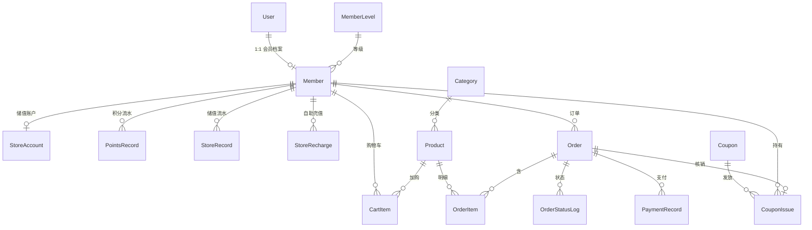

# 数据库设计

库名 `flower_member`，MySQL 8.0，字符集 utf8mb4。ORM：Django 5.2。金额 `Decimal(12,2)`，时间为带时区 DateTime。

## ER 关系（核心）

## 表清单

| 表名 | 模型 | 说明 |
| --- | --- | --- |
| accounts_user（Django 默认名） | accounts.User | 统一账号，`role`=admin/staff/member，`phone` |
| member_level | MemberLevel | 普通/银卡/金卡/钻石，积分阈值、折扣、倍率 |
| member_member | Member | 档案、当前/累计积分、等级 |
| member_points_record | PointsRecord | 积分变动、余额快照、来源、订单号 |
| member_store_value | StoreAccount | 储值余额 |
| member_store_record | StoreRecord | 充值/消费/退款流水 |
| product_category | Category | 商品分类 |
| product_product | Product | 商品、售价、库存、上下架、图片 |
| order_cart | CartItem | 会员+商品唯一 |
| order_order | Order | 订单号、状态、履约方式与地址快照、金额拆分、储值/网关实付、预扣库存 |
| member_store_recharge | StoreRecharge | 会员自助充值待入账单 |
| order_order_item | OrderItem | 名称/SKU/单价快照 |
| order_status_log | OrderStatusLog | 状态变迁 |
| order_payment | PaymentRecord | 模拟网关/储值流水 |
| marketing_coupon | Coupon | 满减/折扣模板、总量、有效期 |
| marketing_coupon_issue | CouponIssue | 领取/核销/过期 |

## 关键约束

- `AUTH_USER_MODEL = accounts.User`，禁止后期再改用户表。
- 购物车 `(member, product)` 唯一。
- 订单 `status`、`paid_at`、`fulfillment` 有显式索引，便于看板与超时扫描按状态过滤。
- 自助充值待入账 `hold_key` 唯一（同一会员同时一张）。
- 一单一张券：`CouponIssue.order` OneToOne。
- 会员等级 `PROTECT`，避免误删等级导致档案失效。

## 金额与状态

应付 = 商品合计 − 等级折扣 − 优惠券。实付 = 储值支付 + 模拟网关。  
订单：待支付 → 已支付 → 配送中 → 已签收；自提为已支付 → 已签收；待支付 → 已取消；已支付 → 待退款审核 → 已退款或回到已支付；已支付/待审核/配送中/已签收 → 已退款。  
看板实收统计已支付、待退款审核、配送中、已签收。
待支付超过 30 分钟未支付，访问首页、花市、订单或看板时自动取消（回库存、退券）。
